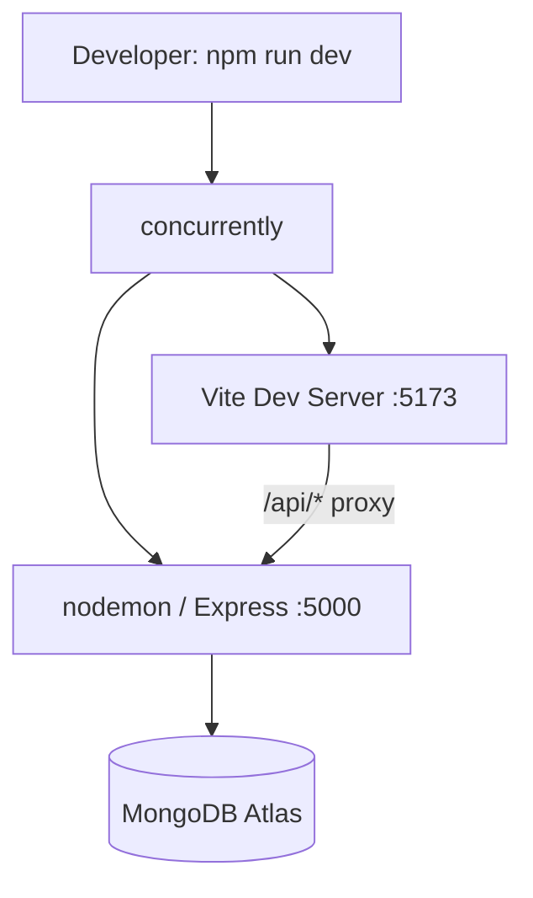

# Design Document — Resume++ Phase 1: Project Setup

## Overview

Phase 1 establishes the complete scaffolding for the Resume++ MERN monorepo. No application logic is implemented in this phase. The goal is a reproducible, zero-error project skeleton that any developer can clone, install, and run with a single set of commands. The deliverables are:

- A two-tier monorepo (client + server) under a common root
- React + Vite + Tailwind CSS frontend boilerplate
- Express + Mongoose backend boilerplate with environment-driven configuration
- Shared root `package.json` with concurrently-powered dev scripts
- `.env.example` covering every secret the full app will need
- `README.md` and a `docs/` folder with skeleton Markdown files

---

## Architecture

The project follows a standard client/server monorepo layout. There is no build-time coupling between the two packages; they share only the root `package.json` convenience scripts.

During development, Vite forwards all `/api/*` requests to the Express server via its built-in proxy, so the browser never needs to know the backend port and CORS issues are minimised.

---

## Components and Interfaces

### Root Level

| File / Dir | Purpose |
|---|---|
| `package.json` | Monorepo scripts; `concurrently` dev dependency |
| `.env.example` | Template for all required environment variables |
| `.gitignore` | Excludes `node_modules/`, `.env`, `dist/`, `*.log` |
| `README.md` | Project overview and setup guide |
| `docs/` | Ten skeleton Markdown documentation files |
| `Logo/` | Raw logo asset (source of truth) |

### Client (`client/`)

| File / Dir | Purpose |
|---|---|
| `vite.config.js` | Port 5173, `/api` proxy to `:5000` |
| `tailwind.config.js` | Content paths covering `src/**/*.{js,jsx}` |
| `postcss.config.js` | Autoprefixer + Tailwind PostCSS plugins |
| `src/index.css` | Three Tailwind directives |
| `src/main.jsx` | React DOM root mount |
| `src/App.jsx` | Root component — minimal placeholder |
| `src/components/` | Reusable UI atoms (empty, ready for Phase 2) |
| `src/pages/` | Page-level components (empty, ready for Phase 2) |
| `src/layouts/` | Layout wrappers (empty, ready for Phase 2) |
| `src/hooks/` | Custom React hooks (empty) |
| `src/services/` | Axios-based API call modules (empty) |
| `src/context/` | React Context providers (empty) |
| `src/utils/` | Pure utility helpers (empty) |
| `client/public/logo.jpeg` | Logo_Asset copied from `Logo/` |

### Server (`server/`)

| File / Dir | Purpose |
|---|---|
| `server.js` | Express app entry; loads dotenv, applies middleware, calls `connectDB`, listens |
| `config/db.js` | Mongoose `connectDB` function |
| `controllers/` | Route handler functions (empty stubs) |
| `routes/` | Express Router files (empty stubs) |
| `models/` | Mongoose model definitions (empty stubs) |
| `middleware/` | Auth, error-handling, validation middleware (empty stubs) |
| `services/jobs/` | External Job API adapter (empty stub) |
| `services/ai/` | AI LLM integration layer (empty stub) |
| `services/resume/` | Resume text-extraction helpers (empty stub) |
| `services/pdf/` | PDF generation helpers (empty stub) |
| `utils/` | Server-side utility helpers (empty stubs) |

---

## Data Models

Phase 1 introduces no Mongoose schemas. `config/db.js` only establishes and exports the database connection. Schemas (users, jobs, savedJobs, resumes, optimizedResumes) are defined in later phases.

---

## Correctness Properties

*A property is a characteristic or behavior that should hold true across all valid executions of a system — essentially, a formal statement about what the system should do. Properties serve as the bridge between human-readable specifications and machine-verifiable correctness guarantees.*

This phase is a project scaffolding and configuration task. It involves creating directory trees, configuring build tools (Vite, Tailwind, PostCSS), and writing static configuration content.

None of these operations are pure functions over a varying input space. The acceptance criteria are SMOKE checks (does the directory exist? does the dev server start?), EXAMPLE checks (does `.env.example` contain the right keys?), or INTEGRATION checks (does `npm run dev` start both processes?).

PBT is **not applicable** for this phase. There are no algorithms, parsers, serialisers, or business-logic functions to test universally. The testing strategy relies entirely on example-based checks and smoke tests.

### Property 1: Scaffolding completeness

For any fresh clone of the repository, after running `npm run install:all`, all required directories and files defined in the project structure SHALL exist at their specified paths without manual intervention.

**Validates: Requirements 1.1, 1.2, 1.3, 1.4, 1.5**

---

## Error Handling

### Server startup validation

`server/server.js` must validate required environment variables immediately after `dotenv.config()` is called, before any middleware or route registration. The check should enumerate all required keys and collect missing ones, then log them all in a single message and call `process.exit(1)`.

Required variables to validate at startup: `MONGODB_URI`, `JWT_SECRET`.

`PORT` and `CLIENT_URL` have safe fallback defaults (`5000` and `http://localhost:5173` respectively) and do not need to be treated as fatal if absent.

### MongoDB connection failure

`config/db.js` wraps `mongoose.connect()` in a try/catch. On failure it logs the error message and calls `process.exit(1)`. This is invoked from `server.js` before the HTTP listener is started, ensuring the server never accepts traffic without a database connection.

### Client dev-server proxy errors

If the Express server is not running when a proxied `/api` request arrives, Vite returns a standard `502` to the browser. No special handling is required in Phase 1.

---

## Testing Strategy

Phase 1 has no application logic, so the testing scope is limited to **smoke tests** that verify the scaffold is correct. These are manual verification steps for Phase 1; automated test infrastructure (Jest, Vitest) will be set up in a later phase.

### Smoke test checklist

1. **Folder structure** — run `ls` (or equivalent) to confirm all required directories and files exist as specified in Requirement 1.
2. **Client dev server** — `cd client && npm run dev` starts without error; browser at `http://localhost:5173` renders the `<App />` component.
3. **Tailwind CSS** — add a temporary `className="text-violet-500"` to `App.jsx`; confirm the colour appears in the browser.
4. **Server dev server** — `cd server && npm run dev` starts without error; terminal shows the startup message with port `5000`.
5. **MongoDB connection** — with `MONGODB_URI` set to a valid Atlas URI, server logs `MongoDB connected`; with an invalid URI, server logs the error and exits with code `1`.
6. **Missing env var** — remove `JWT_SECRET` from `.env`; confirm server logs the missing-variable error and exits with code `1`.
7. **Proxy** — with both servers running, `curl http://localhost:5173/api/health` should reach Express (a simple `GET /api/health` route returning `200` can be wired in `server.js` for this test).
8. **Root scripts** — `npm run dev` from Workspace_Root starts both Client and Server concurrently; `npm run install:all` installs all three `node_modules` trees.
9. **Logo** — `client/public/logo.jpeg` loads at `http://localhost:5173/logo.jpeg`.
10. **`.gitignore`** — `git status` does not show `.env` or `node_modules/` as untracked files.
