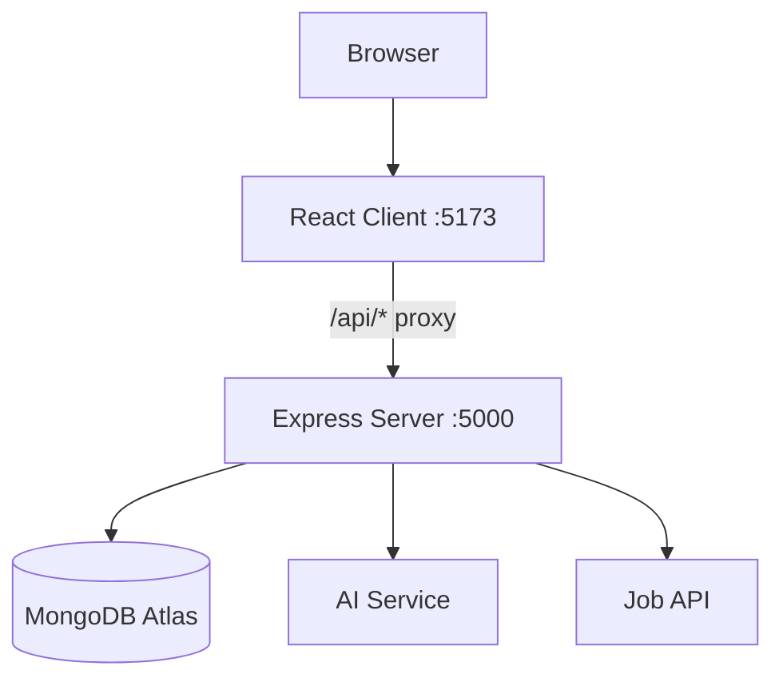

# Architecture

## Overview

Resume++ follows a standard two-tier MERN monorepo layout: a React + Vite frontend (client) and a Node.js + Express backend (server), sharing a common root `package.json` for convenience scripts. There is no build-time coupling between the two packages.

## System Diagram



> During development, Vite forwards all `/api/*` requests to the Express server via its built-in proxy, so the browser never needs to know the backend port and CORS issues are minimised.

## Frontend

The frontend is a React single-page application built with Vite.

**Key technologies:**
- **React** — UI library, functional components, hooks
- **Vite** — Fast build tool and dev server (port 5173)
- **Tailwind CSS** — Utility-first CSS framework
- **React Router** — Client-side routing
- **Axios** — HTTP client for API calls

**Dev server proxy:** All `/api/*` requests are forwarded to `http://localhost:5000` so the browser only ever talks to port 5173.

## Backend

The backend is a Node.js + Express REST API server.

**Key technologies:**
- **Node.js** — JavaScript runtime
- **Express** — Web framework for routing and middleware
- **Mongoose** — MongoDB ODM for schema definition and queries
- **JWT** — Stateless authentication tokens
- **bcryptjs** — Password hashing
- **dotenv** — Environment variable loading
- **CORS** — Cross-origin resource sharing configuration

**Entry point:** `server/server.js` — loads env vars, validates required vars, applies middleware, registers routes, connects to MongoDB, then starts listening.

## Database

MongoDB Atlas is used as the database. Mongoose provides the ODM layer.

**Collections (Phase 4+):**
- `users` — user accounts and auth info
- `jobs` — cached job data from external API
- `savedJobs` — per-user saved job references
- `resumes` — one original resume per user (structured JSON)
- `optimizedResumes` — multiple optimized versions per user

## AI Integration

The AI provider is fully configurable via environment variables. No AI provider is hardcoded in the application.

- `AI_API_KEY` — API key for the chosen LLM provider
- `AI_MODEL` — Model name/identifier (e.g., `gpt-4o`, `claude-3-5-sonnet`)

**Important:** AI keys are loaded server-side only and are **never exposed to the browser**. All AI calls are made from the Express server.

**AI uses:**
1. Resume parsing — converts raw PDF/DOCX text into Standard Resume JSON
2. Resume optimization — rewrites/aligns resume content for a given job description

## Job API Integration

Job search API calls are proxied through the Express server using an **adapter/service layer**.

- `JOB_API_KEY` — API key for the job search provider (never sent to browser)
- `JOB_API_BASE_URL` — Base URL for the job API

**Adapter pattern:** The `server/services/jobs/` layer converts the external API's raw response format into the app's internal **Standard Job JSON** schema. This means:
- The frontend only ever sees the normalized Standard Job JSON
- Switching to a different job API only requires updating the adapter, not any frontend code

## Authentication Flow

```
Browser → POST /api/auth/login → Express → bcrypt verify password
       ← JWT token ←
Browser stores JWT in memory/localStorage
Browser → GET /api/protected → Express → verify JWT → handler
```

Full Google OAuth setup is documented in `authentication.md`.

## Security

- Passwords hashed with bcryptjs (never stored in plain text)
- JWT-based stateless authentication
- Protected routes via auth middleware
- All secrets in `.env` (never committed)
- CORS restricted to `CLIENT_URL`
- Input validation on all endpoints
- File type and size validation for resume uploads
- MongoDB injection protection via Mongoose

See `security.md` for full details.
